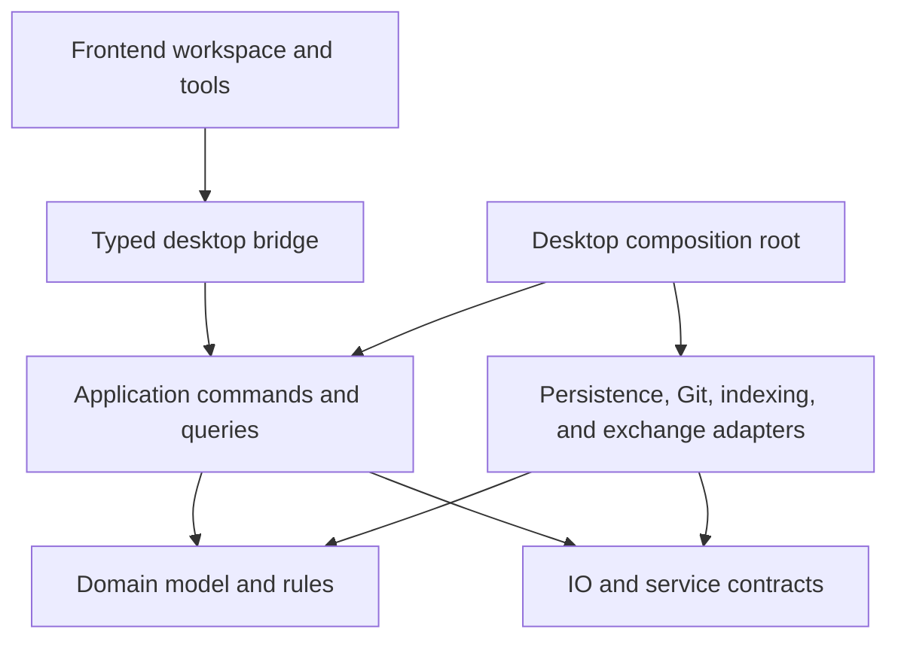

# Architecture direction

Status: architecture direction with an initial headless implementation. Domain, application, JSON adapter, and local check-runner boundaries now exist; hierarchy, reusable revisions, drawing styles, whole conductor routes, and action contracts are implemented; desktop and broader capabilities remain planned. See the [implementation checklist](implementation-checklist.md) and [first implementation decision](decisions/0001-headless-foundation.md).

## Principles

Build a modular desktop application with a headless Rust editing engine. The electrical model must be usable without Tauri, a webview, Git, or a particular renderer. Start as one application, not distributed services or a general-purpose plugin framework.

Rust modules, visibility, and crate dependencies can enforce boundaries, but small functions alone do not establish modularity. Each area needs clear ownership, explicit inputs and outputs, and a documented dependency direction.

Keep difficult-to-reverse choices visible: object identity, electrical topology, command semantics, units, style inheritance, and project schema. Keep replaceable choices behind narrow boundaries: desktop shell, rendering technology, Git implementation, storage encoding, indexing, and CAD import/export libraries.

## Dependency direction



Arrows indicate source dependencies, not runtime data flow. The composition root connects concrete adapters to the application. Adapter modules may depend on the application-owned contracts they implement; application logic does not depend on their concrete implementations. No circular dependencies.

## Responsibilities and ownership

| Area | Owns | Must not own |
| --- | --- | --- |
| Domain | Typed identities, electrical topology, hierarchy, terminal mappings, structured drawing geometry, styles, and invariant checks | Filesystem access, Tauri calls, Git operations, widgets |
| Application | Document sessions, commands, undo/redo, queries, selection applicability, revision tracking, and orchestration | Concrete file/Git libraries or frontend components |
| Persistence adapter | Project-file schema, migration, serialization, asset packaging, and recoverable saves | Electrical editing policy or UI state |
| Git adapter | Repository inspection and explicit repository operations | Document validity, electrical merge policy, automatic commits |
| Presentation/geometry services | Deterministic scene preparation, style resolution, hit-testing and geometry calculations | Independent authoritative electrical state |
| Frontend | Workspace layout, input tools, selection interaction, previews, reusable controls, and rendering | Direct persistent model mutation, authoritative electrical rules |
| Desktop host | Tauri command wiring, application lifetime, OS integration, and service construction | CAD business logic |
| Exchange adapters, later | Pinout import, DXF, STEP packaging, and external schema conversion | Internal device identity policy or implicit engineering assumptions |

These are responsibility boundaries, not a requirement for a crate per row. Presentation and geometry algorithms that establish document semantics belong in reusable core modules; frontend-specific drawing code stays outside them.

## Initial repository shape

Proposed starting shape when implementation begins:

```text
crates/
  ecad-domain/          # Model, geometry, invariants, style/property definitions
  ecad-app/             # Sessions, commands, history, queries, service contracts
  ecad-adapters/        # Project files, Git, assets; isolated internal modules
apps/
  desktop/
    src-tauri/         # Thin host and typed bridge
    src/
      shell/           # Workspace geometry and pane lifecycle
      ui/              # Shared controls and UI tokens
      features/        # Hierarchy, drawing, inspector, library, Git views
      bridge/          # Transport types, calls, subscriptions
docs/
  decisions/           # Short architecture decision records as choices are made
```

Create modules and crates when working features need them, not as empty scaffolding for every future capability. Split the adapter crate or domain modules further when dependency weight, reuse, ownership, or compilation boundaries justify it. Do not use a generic `common` crate as a dumping ground.

## Domain boundaries

Organize the domain by responsibilities such as identities/units, electrical topology, hierarchy, drawing representations, styles/properties, and library references. Use explicit typed references between objects. A device ID, terminal ID, and view ID must not be interchangeable strings.

One device can have several schematic symbols, a connector face diagram, a physical footprint, and a 3D asset association. Their geometry is separate; their device and terminal references are shared. Domain types distinguish physical dimensions from drawing dimensions and document coordinates from screen pixels.

Keep internal mutable collections private. Queries return read views or purpose-built results; mutations pass through methods that preserve invariants. Avoid a universally mutable project object exposed throughout the codebase.

Property definitions describe stable identity, type, units, applicability, ownership, constraints, and inheritance. Build typed access to real model fields; do not flatten the whole domain into an unvalidated string-to-value map to simplify the inspector. Custom properties will have an explicit schema and extension mechanism. The first implemented registry maps 15 typed fields directly onto existing electrical objects, with typed reference constraints, effective pin/structural restrictions, union inspection, and preflighted compound commands. It adds no generic persisted property bags or new schema fields. See [decision 0009](decisions/0009-electrical-property-contract.md). Creation presets and inherited graphical styles now use distinct persisted contracts on drawing views, annotations, and graphical polylines. Per-property resolution preserves explicit override intent, including equal-valued assignments, and localized history restores intent as well as value. See [decision 0010](decisions/0010-drawing-defaults-and-styles.md). Visual fields remain separate from device/conductor identity.

Whole conductor routes reference existing electrical IDs; view-local anchors place real terminals. One conductor may have one route per view with independent geometry. Project validation enforces exact A/B terminal continuity, while reverse indexes limit anchor movement to touching routes. Geometry never infers junctions or changes electrical topology. See [decision 0012](decisions/0012-whole-conductor-routes.md).

## Commands, transactions, and undo

A proposed edit carries explicit parameters and targets. The application resolves applicability, validates the complete operation, and prepares a change before committing it. Success produces a change summary and an undo record; failure leaves the authoritative document and history unchanged.

Undo records retain enough information to restore deleted data, references, assignments, and layout exactly. Prefer reversible change sets or localized before/after data initially; do not assume every command has a simple mathematical inverse. Avoid requiring full-project copies for every pointer update.

One completed drag, bulk edit, or alignment is one user operation. Preview geometry stays transient until accepted. Undo/redo uses the same invariant-preserving document boundary, while restoring original identities rather than generating new ones. The initial implementation supports ordered compound transactions, saved-state checkpoints, and process-local session epochs; see [decision 0002](decisions/0002-transactions-and-session-checkpoints.md). Byte budgets and external document-replacement orchestration remain pending.

This command model does not imply event sourcing, persisted undo across restarts, or using the undo log as the project format. Those are separate decisions.

## Action registry and input routing

Use a central registry of user-facing action identities, context/enabled rules, invocation requirements, and default binding policies. Menus, toolbars, context menus, shortcut help, and the command palette reference it. Feature modules register behavior without creating separate keyboard dispatch paths. Native menu adapters and frontend input handling must not double-dispatch an action.

Keep action dispatch distinct from document command execution: an action may enter a tool or open UI; a committed edit passes through the application command boundary. Store keymap overrides as user/workspace preferences. The implemented headless registry/router/dispatcher shares availability and typed invocation across surfaces, with captured-context revalidation, protected input, explicit repeat behavior, sequence cancellation, and host-input replay checks. Strict keymap schema v1 is independent of project data; native event/menu integration remains future work. See [decision 0011](decisions/0011-action-registry-and-keymaps.md). Context routing, typing protection, deterministic targets, and sequence conflicts are explicit contracts. See [Keyboard and action model](keyboard-actions.md).

## Frontend/core contract

Use a small, typed bridge supporting document operations, editing commands, queries, and revisioned change notifications. Keep transport DTOs distinct from internal model and persisted-file schemas so changing one boundary does not accidentally change all three.

Use a shared or generated source for bridge types once the frontend stack is selected. Validate incoming data at the Rust boundary. Errors have stable categories, affected object references where applicable, and human-readable context; expected validation errors are structured results rather than panics or opaque strings.

The Rust session owns the committed document. Frontend state is a revisioned read projection plus ephemeral tool state. Commands should identify their base document revision; stale commands and out-of-order results must be rejected or explicitly reconciled. Provide a snapshot/resynchronization path after missed updates.

Do not require a synchronous round trip for every pointer movement. Allow local interaction previews using shared rules or a clearly bounded approximation, then validate the committed command in the core. The final result must match the preview or visibly explain why it cannot be applied. Prototype shared geometry via native calls, frontend code, or WebAssembly before selecting an approach.

Long-running indexing, loading, imports, and geometry work must not block the interactive event loop. Define cancellation and progress at operation boundaries, and discard stale results rather than applying them to a changed document. Do not introduce async into pure domain functions without a concrete need.

## Persistence and external services

The authoritative document is the in-memory validated project; the authoritative saved form is a versioned text project plus its referenced assets. A SQLite index, renderer cache, or frontend projection must be reconstructible and identified by the revision it represents.

The persistence adapter translates between domain objects and explicit disk DTOs, validates loaded projects, and handles migrations deliberately. An internal struct refactor should not silently alter the disk format. Stable IDs, deterministic ordering, defined numeric encoding, and deliberate file boundaries support useful Git diffs.

The implemented v6 format stores a separate drawing aggregate, electrically anchored routes, and portable style/default settings alongside project lineage, hierarchy, interfaces, cables, immutable subsystem revisions, occurrence mappings, and local ancestry. V2–v5 loading preserves electrical identities and existing drawing content; v1 migration remains explicit. See [decision 0005](decisions/0005-reusable-subsystem-revisions.md) for reuse, ownership, and undo semantics. See [decision 0004](decisions/0004-local-hierarchy-and-cables.md) for the initial hierarchy semantics. `Document<S>` orchestrates observed-version saves, save-as, and validated reloads through `VersionedProjectStore`. See [decision 0003](decisions/0003-project-identity-and-guarded-reload.md) for the optimistic file-check guarantees and remaining concurrent-writer limitations.

Saving a multi-file project needs a defined recovery protocol; independent per-file atomic writes alone do not make a whole-project save atomic. Prototype crash recovery and detection of externally changed files before claiming reliable saves.

Repository operations go through application orchestration: resolve dirty documents, perform the operation, detect conflicts, load/validate changed project data, then replace the session and its history coherently. A textual merge is not proof of a valid electrical model. Keep external Git CLI use supported and detect its working-tree changes.

Library definitions used by a project are pinned or copied into project-owned versions. Manufacturer catalogues, asset downloads, and the existing pinout generator remain adapters or import sources. Core editing must remain available offline.

Reusable subsystems distinguish definition lineage, immutable revision, and placed occurrence identity. Exact pinned occurrences support explicit adoption with stable local-to-placed matching and atomic candidate validation; see [decision 0006](decisions/0006-explicit-revision-adoption.md). Local-variant merging remains deferred. Local shared publication persists immutable bodies and explicit recommendations independently of project history; the library adapter coordinates cooperating writers and rejects history rewrites. See [decision 0007](decisions/0007-shared-subsystem-library.md). Publication never silently updates consuming projects. A read-only in-memory known-use index covers explicit registered locations, retaining labelled historical references after read failures and separating file location from project lineage; see [decision 0008](decisions/0008-registered-project-usage.md). Durable registries/watchers remain deferred. See [Hierarchy, scale, and shared revisions](hierarchy-and-revisions.md) for editing, publication, and adoption contracts.

Target car-scale equipment first. Hierarchical queries, revision-keyed reusable data, and affected-region invalidation should avoid complete project expansion on every edit. Full-project checks still account for all instances. Prohibit containment/definition cycles and set explicit depth and expanded-instance budgets from measured fixtures; arbitrary depth limits alone do not establish determinism or performance.

Provide measurement points around command processing, invalidation, scene preparation, loading, and persistence. Use locally reproducible [scalability experiments](testing-strategy.md#scalability-experiments) to identify bottlenecks and validate architectural changes. Benchmark both headless work and native interaction, preserving correctness checks and avoiding unsupported capacity claims.

## Rendering and future exchange

Define an explicit representation/scene boundary for paths, symbols, text, tables, images, and resolved styles. Interactive rendering and print/export share document geometry and style semantics; they may use different rendering backends. Test text measurement, fonts, coordinates, and export parity in the rendering prototype.

Physical footprints, imported CAD geometry, and 3D assets must not inherit assumptions from screen-space drawing primitives. Preserve source assets, units, coordinate frames, instance transforms, and mappings to stable device identities. Use an exchange adapter for format-specific details and report unsupported data.

Avoid choosing a CAD kernel, a global routing solver, or a Python runtime dependency merely to reserve these capabilities. Preserve the contracts and validate the specific technology when that work begins.

## Checks that protect boundaries

Unit, regression, and integration testing are required, locally runnable architecture concerns. Target Linux, Windows, and macOS from the start, while retaining a headless core that can be exercised without the desktop host. See [Testing and platform strategy](testing-strategy.md) for suite responsibilities and the native validation matrix. Hosted GitHub checks can supplement, rather than replace, the local workflow.

- Core tests run without opening a window or constructing a Tauri application.
- Crate dependency checks prevent domain/application dependencies on concrete adapters or Tauri.
- Domain tests cover invariants; command tests cover successful edits, rejection without mutation, undo, and redo.
- Persistence fixtures cover round trips, migrations, stable serialization, missing assets, and recovery behavior.
- Adapter contract tests cover external outcomes; UI interaction tests cover focus, geometry stability, and preview/commit behavior where those risks arise.
- Bridge checks prevent drift between frontend types and Rust DTOs.

Add these checks with the implementation they protect. Do not build a large test infrastructure for speculative features.

## Decisions and reassessment

For a consequential choice, record its context, options considered, decision, tradeoffs, and conditions for revisiting it in a short architecture decision record. Identify a replacement path or migration cost rather than claiming every implementation will be interchangeable.

Before committing to the UI and persistence stack, prototype structured route editing, large-drawing interaction, property/style resolution, deterministic saves, recovery, and Git reload behavior. Use representative project sizes and agree performance targets during requirements work.

Firm rules are ownership, dependency direction, explicit mutation, portability, and contract clarity. Provisional choices include frontend framework, rendering backend, exact file partitioning, history storage, Git library versus CLI, and SQLite indexing.

## Reference guidance

The proposed headless-core boundary is consistent with [Tauri's core/webview process separation](https://v2.tauri.app/concept/process-model/). Specific module and command contracts above are project design proposals, not requirements imposed by Tauri.
