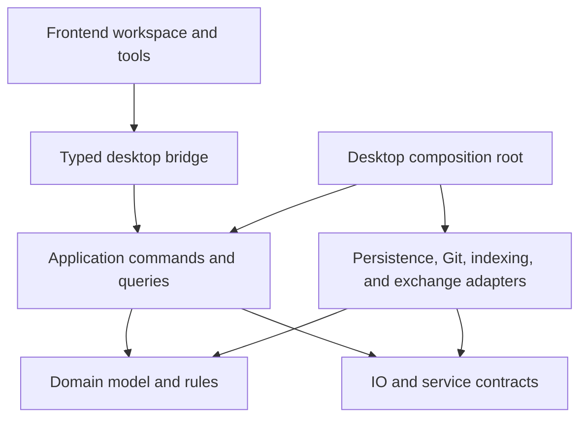

# Architecture direction

Status: architecture direction with an initial headless implementation. Domain, application, JSON adapter, and local check-runner boundaries now exist; hierarchy, reusable revisions, drawing styles, whole conductor routes, and action contracts are implemented; a bounded Tauri desktop prototype is implemented on macOS; broader native/platform capabilities remain planned. See the [implementation checklist](implementation-checklist.md) and [first implementation decision](decisions/0001-headless-foundation.md).

## Principles

Build a modular desktop application with a headless Rust editing engine. The electrical model must be usable without Tauri, a webview, Git, or a particular renderer. Start as one application, not distributed services or a general-purpose plugin framework.

Rust modules, visibility, and crate dependencies can enforce boundaries, but small functions alone do not establish modularity. Each area needs clear ownership, explicit inputs and outputs, and a documented dependency direction.

Keep difficult-to-reverse choices visible: object identity, electrical topology, command semantics, units, style inheritance, and project schema. Keep replaceable choices behind narrow boundaries: desktop shell, rendering technology, Git implementation, storage encoding, indexing, and CAD import/export libraries.

## Project drawing structure: revised target

Actual project drawing workspaces are Project → Documents → Sheets. A logical drawing document owns metadata, a default template and ordered sheets; it is distinct from the application's existing Document<S> session/save controller and need not become a separate disk file. Each sheet resolves a project-bundled template and is edited directly with its border, drawing information and schematic content visible. The v8 Model view/read-only paper split is a prototype that must be replaced, not the basis for further template UI.

Keep internal representation geometry, sheet/template geometry, electrical topology and viewport state separate. Apply validated sheet-coordinate mappings to pointer/snapping/edit commands rather than treating the rendered sheet as an output-only wrapper. Library symbol/component/footprint and template-definition editors use distinct workspace contexts; they are not forced into schematic paper sheets. Electrical hierarchy links to stable sheet identities/interfaces independently of document ownership. Output sets select sheets/documents without owning them.

The default left explorer is a page/sheet navigator, with electrical structure available separately. Main-area sheet tabs retain local camera/selection while sharing the project session/history. Hierarchical blocks and continuation connectors reference stable sheet/interface/connectivity identities, not displayed text. Cover, generated drawing-list, overview and detailed sheets all resolve a CAD template.

The next implementation must introduce logical document ownership and a content-preserving migration before unifying the sheet editor and template frame. Existing v8 geometry, mappings and identifiers must not be flattened, silently duplicated, renumbered or rewired. See [decision 0030](decisions/0030-sheet-first-project-documents.md).

## Multi-project workspace

The target explorer can hold several project roots. Electrical/component structure is selected per project; project sheet tabs share that project's history, never another project's model or checkpoint. Use process-local open-project handles rather than persistent ProjectId alone: copied/branched files can have identical lineage and electrical IDs. All delayed operations retain their original handle and revision.

The first implemented foundation is ProjectWorkspace<S>, owning independent Document<S> controllers in open order, with explicit project-targeted edits/actions/save/reload/close and a workspace-wide action input stream. Host-normalized opaque location keys provide duplicate-open focus and Save-as reservation; path/alias normalization remains a host responsibility. Workspace selection is transient, and reload retains the workspace handle while replacing the session epoch. The desktop host/bridge is not yet wired to this owner. Follow [the task/rework list](workspace-and-sheet-implementation.md) and [decision 0031](decisions/0031-multi-project-workspace-foundation.md).

## Dependency direction



Arrows indicate source dependencies, not runtime data flow. The composition root connects concrete adapters to the application. Adapter modules may depend on the application-owned contracts they implement; application logic does not depend on their concrete implementations. No circular dependencies.

## Responsibilities and ownership

| Area | Owns | Must not own |
| --- | --- | --- |
| Domain | Typed identities, electrical topology, hierarchy, terminal mappings, structured drawing geometry, styles, and invariant checks | Filesystem access, Tauri calls, Git operations, widgets |
| Application | Document sessions, commands, undo/redo, queries, selection applicability, revision tracking, and orchestration | Concrete file/Git libraries or frontend components |
| Persistence adapter | Project-file schema, migration, serialization, asset packaging, and recoverable saves | Electrical editing policy or UI state |
| Git adapter | Repository inspection and explicit repository operations | Document validity, electrical merge policy, automatic commits |
| Presentation/geometry services | Deterministic scene preparation, style resolution, hit-testing and geometry calculations | Independent authoritative electrical state |
| Frontend | Workspace layout, input tools, selection interaction, previews, reusable controls, and rendering | Direct persistent model mutation, authoritative electrical rules |
| Desktop host | Tauri command wiring, application lifetime, OS integration, and service construction | CAD business logic |
| Exchange adapters, later | Pinout import, DXF, STEP packaging, and external schema conversion | Internal device identity policy or implicit engineering assumptions |

These are responsibility boundaries, not a requirement for a crate per row. Presentation and geometry algorithms that establish document semantics belong in reusable core modules; frontend-specific drawing code stays outside them.

## Initial repository shape

The core crates and desktop host now follow this shape; further feature directories are added only when needed:

```text
crates/
  ecad-domain/          # Model, geometry, invariants, style/property definitions
  ecad-app/             # Sessions, commands, history, queries, service contracts
  ecad-adapters/        # Project files, Git, assets; isolated internal modules
  ecad-bridge/          # Desktop DTOs/projections and guarded controller
apps/
  desktop/
    src-tauri/         # Thin host and typed bridge
    src/
      shell/           # Workspace geometry and pane lifecycle
      ui/              # Shared controls and UI tokens
      features/        # Hierarchy, drawing, inspector, library, Git views
      bridge/          # Transport types, calls, subscriptions
docs/
  decisions/           # Short architecture decision records as choices are made
```

Create modules and crates when working features need them, not as empty scaffolding for every future capability. Split the adapter crate or domain modules further when dependency weight, reuse, ownership, or compilation boundaries justify it. Do not use a generic `common` crate as a dumping ground.

## Domain boundaries

Organize the domain by responsibilities such as identities/units, electrical topology, hierarchy, drawing representations, styles/properties, and library references. Use explicit typed references between objects. A device ID, terminal ID, and view ID must not be interchangeable strings.

One device can have several schematic symbols, a connector face diagram, a physical footprint, and a 3D asset association. Their geometry is separate; their device and terminal references are shared. Domain types distinguish physical dimensions from drawing dimensions and document coordinates from screen pixels.

Keep internal mutable collections private. Queries return read views or purpose-built results; mutations pass through methods that preserve invariants. Avoid a universally mutable project object exposed throughout the codebase.

Property definitions describe stable identity, type, units, applicability, ownership, constraints, and inheritance. Build typed access to real model fields; do not flatten the whole domain into an unvalidated string-to-value map to simplify the inspector. Custom properties will have an explicit schema and extension mechanism. The first implemented registry maps 15 typed fields directly onto existing electrical objects, with typed reference constraints, effective pin/structural restrictions, union inspection, and preflighted compound commands. It adds no generic persisted property bags or new schema fields. See [decision 0009](decisions/0009-electrical-property-contract.md). Creation presets and inherited graphical styles now use distinct persisted contracts on drawing views, annotations, and graphical polylines. Per-property resolution preserves explicit override intent, including equal-valued assignments, and localized history restores intent as well as value. See [decision 0010](decisions/0010-drawing-defaults-and-styles.md). Visual fields remain separate from device/conductor identity.

Whole conductor routes reference existing electrical IDs; view-local anchors place real terminals. One conductor may have one route per view with independent geometry. Project validation enforces exact A/B terminal continuity, while reverse indexes limit anchor movement to touching routes. Geometry never infers junctions or changes electrical topology. See [decision 0012](decisions/0012-whole-conductor-routes.md).

Numeric layout plans act on explicit drawing origins, with deterministic identity ties and checked micrometre arithmetic. A simultaneous anchor command adjusts the union of touching routes once and translates whole routes when both endpoints share an offset. Preflight uses a temporary candidate; undo retains exact localized state. Renderer bounds and persistent constraints are separate future contracts. See [decision 0013](decisions/0013-origin-layout-and-group-movement.md).

Orthogonal transforms operate on complete selected path geometry and selected terminal placements. Fully internal routes transform every vertex; boundary routes adjust locally. Explicit pivots, checked integer arithmetic, fixed-origin geometry reporting, and exact localized layout snapshots preserve deterministic edits and undo. Action invocation data and dispatch orchestration now live in separate cohesive modules without changing root public APIs. See [decision 0015](decisions/0015-orthogonal-group-transforms.md).

## Commands, transactions, and undo

A proposed edit carries explicit parameters and targets. The application resolves applicability, validates the complete operation, and prepares a change before committing it. Success produces a change summary and an undo record; failure leaves the authoritative document and history unchanged.

Undo records retain enough information to restore deleted data, references, assignments, and layout exactly. Prefer reversible change sets or localized before/after data initially; do not assume every command has a simple mathematical inverse. Avoid requiring full-project copies for every pointer update.

One completed drag, bulk edit, or alignment is one user operation. Preview geometry stays transient until accepted. Undo/redo uses the same invariant-preserving document boundary, while restoring original identities rather than generating new ones. The initial implementation supports ordered compound transactions, saved-state checkpoints, and process-local session epochs; see [decision 0002](decisions/0002-transactions-and-session-checkpoints.md). Byte budgets and external document-replacement orchestration remain pending.

This command model does not imply event sourcing, persisted undo across restarts, or using the undo log as the project format. Those are separate decisions.

## Action registry and input routing

Use a central registry of user-facing action identities, context/enabled rules, invocation requirements, and default binding policies. Menus, toolbars, context menus, shortcut help, and the command palette reference it. Feature modules register behavior without creating separate keyboard dispatch paths. Native menu adapters and frontend input handling must not double-dispatch an action.

Keep action dispatch distinct from document command execution: an action may enter a tool or open UI; a committed edit passes through the application command boundary. Store keymap overrides as user/workspace preferences. The implemented headless registry/router/dispatcher shares availability and typed invocation across surfaces, with captured-context revalidation, protected input, explicit repeat behavior, sequence cancellation, and host-input replay checks. Strict keymap schema v1 is independent of project data; native event/menu integration remains future work. See [decision 0011](decisions/0011-action-registry-and-keymaps.md). Context routing, typing protection, deterministic targets, and sequence conflicts are explicit contracts. See [Keyboard and action model](keyboard-actions.md).

## Frontend/core contract

The headless preview contract now exposes immutable exact candidate records for layout and snapped movement, retaining the original session revision and closed commands. Prepare and commit share validated layout rules; commit never re-queries snap targets. The M action supports preview/commit parameters as well as immediate numeric layout. Snap queries are deterministic, view-scoped, and transient, with explicit exclusions/tolerance; the first implementation scans geometry linearly. Project schema v6 is unchanged. See [decision 0014](decisions/0014-deterministic-snapping-and-previews.md). Bridge-v1 DTOs, an SVG read projection, and a bounded Tauri host are now implemented; native tool previews and comprehensive native interaction remain pending.

Use a small, typed bridge supporting document operations, editing commands, queries, and revisioned change notifications. Keep transport DTOs distinct from internal model and persisted-file schemas so changing one boundary does not accidentally change all three.

Use a shared or generated source for bridge types once the frontend stack is selected. Validate incoming data at the Rust boundary. Errors have stable categories, affected object references where applicable, and human-readable context; expected validation errors are structured results rather than panics or opaque strings.

The Rust session owns the committed document. Frontend state is a revisioned read projection plus ephemeral tool state. Commands should identify their base document revision; stale commands and out-of-order results must be rejected or explicitly reconciled. Provide a snapshot/resynchronization path after missed updates.

Do not require a synchronous round trip for every pointer movement. Allow local interaction previews using shared rules or a clearly bounded approximation, then validate the committed command in the core. The final result must match the preview or visibly explain why it cannot be applied. Prototype shared geometry via native calls, frontend code, or WebAssembly before selecting an approach.

Long-running indexing, loading, imports, and geometry work must not block the interactive event loop. Define cancellation and progress at operation boundaries, and discard stale results rather than applying them to a changed document. Do not introduce async into pure domain functions without a concrete need.

## First desktop composition

The Tauri host lives in a separate Cargo project with its own lockfile. It connects a mutex-owned `ecad-bridge` controller to native file choosers and a TypeScript/SVG workspace; the main workspace remains testable without native webview libraries. Project state, validation, property plans, history, and guarded persistence stay in Rust. Whole projections carry string-encoded revision tokens and typed identities; exact property values remain strings, while millimetre floats serve scene presentation only. A browser-only loopback test host uses the same bridge and actual files in isolated temporary locations. It is not a production service or alternate electrical model. See [decision 0017](decisions/0017-first-desktop-slice.md).

## Derived electrical reports

`ConnectionReport` captures a revision-bound immutable projection of actual electrical occurrences, terminals, conductors, cables, and hierarchy. All attached ends remain explicit; drawing copies and unplaced source bodies do not duplicate engineering objects. App-owned records keep identity and display labels separate. The CSV adapter formats wire, terminal, and cable views from the same report without adding persisted fields or alternate electrical state. Current-value encoding checks original session freshness; historical encoding is deliberate. See [decision 0016](decisions/0016-electrical-connection-reports.md). Placed live labels, automatic view refresh, and native export lifecycle remain future work.

## Persistence and external services

The authoritative document is the in-memory validated project; the authoritative saved form is a versioned text project plus its referenced assets. A SQLite index, renderer cache, or frontend projection must be reconstructible and identified by the revision it represents.

The persistence adapter translates between domain objects and explicit disk DTOs, validates loaded projects, and handles migrations deliberately. An internal struct refactor should not silently alter the disk format. Stable IDs, deterministic ordering, defined numeric encoding, and deliberate file boundaries support useful Git diffs.

The implemented v12 format adds project-owned complete template bodies to the v11 page/default contracts, logical drawing-document ownership, paper placement, portable metadata, drawing styles/routes and electrical hierarchy/reuse. Readers retain v2–v11 compatibility, supply deterministic missing legacy structure and preserve existing identities/content; v1 still requires explicit lineage migration. Template import is an ordinary reversible project edit, separate from shared publication and actual sheet assignment. See [decision 0039](decisions/0039-project-template-bundles-and-legacy-capture.md). `Document<S>` orchestrates observed-version saves, save-as and validated reloads through `VersionedProjectStore`; [decision 0003](decisions/0003-project-identity-and-guarded-reload.md) states the optimistic check guarantees and concurrent-writer limits.

Saving a multi-file project needs a defined recovery protocol; independent per-file atomic writes alone do not make a whole-project save atomic. Prototype crash recovery and detection of externally changed files before claiming reliable saves.

Repository operations go through application orchestration: resolve dirty documents, perform the operation, detect conflicts, load/validate changed project data, then replace the session and its history coherently. A textual merge is not proof of a valid electrical model. Keep external Git CLI use supported and detect its working-tree changes.

Library definitions used by a project are pinned or copied into project-owned versions. Manufacturer catalogues, asset downloads, and the existing pinout generator remain adapters or import sources. Core editing must remain available offline.

Reusable subsystems distinguish definition lineage, immutable revision, and placed occurrence identity. Exact pinned occurrences support explicit adoption with stable local-to-placed matching and atomic candidate validation; see [decision 0006](decisions/0006-explicit-revision-adoption.md). Local-variant merging remains deferred. Local shared publication persists immutable bodies and explicit recommendations independently of project history; the library adapter coordinates cooperating writers and rejects history rewrites. See [decision 0007](decisions/0007-shared-subsystem-library.md). Publication never silently updates consuming projects. A read-only in-memory known-use index covers explicit registered locations, retaining labelled historical references after read failures and separating file location from project lineage; see [decision 0008](decisions/0008-registered-project-usage.md). Durable registries/watchers remain deferred. See [Hierarchy, scale, and shared revisions](hierarchy-and-revisions.md) for editing, publication, and adoption contracts.

Target car-scale equipment first. Hierarchical queries, revision-keyed reusable data, and affected-region invalidation should avoid complete project expansion on every edit. Full-project checks still account for all instances. Prohibit containment/definition cycles and set explicit depth and expanded-instance budgets from measured fixtures; arbitrary depth limits alone do not establish determinism or performance.

Provide measurement points around command processing, invalidation, scene preparation, loading, and persistence. Use locally reproducible [scalability experiments](testing-strategy.md#scalability-experiments) to identify bottlenecks and validate architectural changes. Benchmark both headless work and native interaction, preserving correctness checks and avoiding unsupported capacity claims.

## Rendering and future exchange

Define an explicit representation/scene boundary for paths, symbols, text, tables, images, and resolved styles. Interactive rendering and print/export share document geometry and style semantics; they may use different rendering backends. Test text measurement, fonts, coordinates, and export parity in the rendering prototype.

Physical footprints, imported CAD geometry, and 3D assets must not inherit assumptions from screen-space drawing primitives. Preserve source assets, units, coordinate frames, instance transforms, and mappings to stable device identities. Use an exchange adapter for format-specific details and report unsupported data.

Avoid choosing a CAD kernel, a global routing solver, or a Python runtime dependency merely to reserve these capabilities. Preserve the contracts and validate the specific technology when that work begins.

## Checks that protect boundaries

Unit, regression, and integration testing are required, locally runnable architecture concerns. Target Linux, Windows, and macOS from the start, while retaining a headless core that can be exercised without the desktop host. See [Testing and platform strategy](testing-strategy.md) for suite responsibilities and the native validation matrix. Hosted GitHub checks can supplement, rather than replace, the local workflow.

- Core tests run without opening a window or constructing a Tauri application.
- Crate dependency checks prevent domain/application dependencies on concrete adapters or Tauri.
- Domain tests cover invariants; command tests cover successful edits, rejection without mutation, undo, and redo.
- Persistence fixtures cover round trips, migrations, stable serialization, missing assets, and recovery behavior.
- Adapter contract tests cover external outcomes; UI interaction tests cover focus, geometry stability, and preview/commit behavior where those risks arise.
- Bridge checks prevent drift between frontend types and Rust DTOs.

Add these checks with the implementation they protect. Do not build a large test infrastructure for speculative features.

## Decisions and reassessment

For a consequential choice, record its context, options considered, decision, tradeoffs, and conditions for revisiting it in a short architecture decision record. Identify a replacement path or migration cost rather than claiming every implementation will be interchangeable.

Before committing to the UI and persistence stack, prototype structured route editing, large-drawing interaction, property/style resolution, deterministic saves, recovery, and Git reload behavior. Use representative project sizes and agree performance targets during requirements work.

Firm rules are ownership, dependency direction, explicit mutation, portability, and contract clarity. Provisional choices include frontend framework, rendering backend, exact file partitioning, history storage, Git library versus CLI, and SQLite indexing.

## Reference guidance

The proposed headless-core boundary is consistent with [Tauri's core/webview process separation](https://v2.tauri.app/concept/process-model/). Specific module and command contracts above are project design proposals, not requirements imposed by Tauri.

## Sheets and template metadata

ProjectMetadata stores literal values keyed by MetadataField independently of electrical objects and drawing geometry. Command::ProjectMetadata restores exact previous values, while the document registry exposes document.metadata.edit. The strict v7 adapter rejects unknown/duplicate metadata keys; v2–v6 load with empty metadata. Subsystem revision bodies explicitly reject project metadata, preserving the electrical library boundary. Future user/company profiles copy values into projects deliberately; sheets/templates resolve project copies rather than machine-global state. See [sheets and templates](sheets-and-templates.md) and [decision 0027](decisions/0027-project-metadata-and-sheet-scope.md).

CompanyProfile and ProfileImportPreview live in the application layer: profile values are restricted to contact metadata, and import preparation captures exact copied project values and the session revision. ProfileFile owns strict independent profile-v1 DTOs and optimistic staged IO. The native host supplies an application-config path; browser tests supply an isolated temporary path. ProfilePanel retains observed file versions and proposal tokens separately from document state; settings transport orchestration is extracted from the main controller. Profile saves bypass project history, while reviewed imports use the existing metadata action/command. No profile path or live profile reference enters project schema v7. See [decision 0028](decisions/0028-company-profiles-and-reviewed-import.md).

Implemented v8 prototype (superseded target workflow): DrawingSheet owns paper dimensions/margins and one optional SheetViewPlacement; Project retains an explicitly ordered initial drawing set independently of its DrawingDocument. SheetCommand has localized exact inverses; SheetPreview retains a validated complete paper edit and original revision. The renderer maps model points to paper via explicit origins and a positive rational scale without changing source records. Sheet and view IDs are distinct, and referenced views cannot be deleted. Strict project-v8 DTOs retain independent v7 loading. UI paper display is read-only; source tools remain in Model view. See [decision 0029](decisions/0029-paper-sheets-and-view-placement.md).

ProjectDrawingDocument is now the logical package type, distinct from DrawingDocument (geometry aggregate) and Document<S> (session/save controller). Every sheet belongs to one package; project sheets are maintained in document/owner-local order, with a derived ownership index. DrawingDocumentCommand stores localized metadata/membership inverses, while sheet removal undo restores its explicit owner/local index. Strict v9 stores sheet records by identity and treats document memberships as the sole order authority. Legacy ownership upgrades derive the default typed document ID from project identity without generating random IDs on load. See [decision 0032](decisions/0032-logical-drawing-documents.md). Schema v10 adds a mandatory immutable standard-v1 default to each package; live frame geometry/typed field values resolve in the domain and use separate display DTOs. See [decision 0033](decisions/0033-bundled-sheet-frame.md). The unified editable sheet UI is implemented using inverse paper placement, source-unit tools and optional captured sheet identity in actions. Custom templates remain pending. See [decision 0034](decisions/0034-editable-sheet-workspace.md).

The bounded desktop now defaults to project/document/sheet navigation, with an alternate electrical explorer for its single open project. Both use read projections and stable identities; expansion/mode/focus stay in workspace state. A bridge-derived exact initial-package hint controls sole-default-group elision. Mode actions use typed host requests through the registry without document commands. See [decision 0035](decisions/0035-project-page-and-electrical-explorers.md); multi-project host routing and scoped tabs remain future work.

Project properties now own three creation-template defaults, separate from document defaults and each sheet's pinned override. Cover/list roles forbid schematic placements. New schematic view and sheet creation form one closed, revision-guarded transaction; generated drawing-list rows are read projections with stable targets, not persisted graphical/electrical copies. Strict v11 conversion preserves legacy sheet appearance. See [decision 0036](decisions/0036-project-template-defaults-and-typed-pages.md).

The next template workflow is planned in [decision 0037](decisions/0037-library-template-editor-workspace.md): a separate library definition editor owns paper/profile geometry, structured title blocks, contextual ribbon/properties and an independent history. Projects assign and bundle only saved revisions/size variants. Saved-reference migration and read-only paper projections are now implemented; the first independent editor is now implemented below. See [the implementation plan](template-editor-plan.md).

Closed immutable template publication is implemented outside project undo ([decision 0038](decisions/0038-closed-template-revision-publication.md)). Project bundles and explicit revision-bound legacy layout capture are implemented in v12 ([decision 0039](decisions/0039-project-template-bundles-and-legacy-capture.md)). Capture does not silently adopt its bodies; actual sheet/default assignment conversion and the independent editor remain pending. Reusable electrical content rejects template-bearing project bodies.

Saved-reference assignment is implemented in [decision 0040](decisions/0040-saved-template-assignments-and-inherited-variants.md). The desktop's loading policy normalizes legacy choices into project-bundled saved families before a clean checkpoint, retaining exact observed source bytes for conflict checks. Schema v13 carries typed pins and inherited variant IDs; raw headless compatibility remains explicit. Paper is an exact validated projection of the saved layout. In-use guards cover creation/document defaults and sheet overrides; atomic assignment snapshots provide exact migration/adoption undo without storing electrical history copies. The first independent template editor/workspace and contextual ribbon/properties are now implemented below.


`TemplateDocument` owns an independent revision epoch, exact variant-replacement history and publication checkpoint without an electrical project. `TemplateWorkspace` in the desktop bridge hosts one editor and a lazily observed local publisher; publishing is outside project history, while explicit import is a project command. A separate captured editor token routes Save/Undo/Redo/Properties/Fit and registered template actions through the shared registry/router/dispatcher/input stream. Applied drafts and pending fields participate in native close guards. Exact bridge DTOs and the placeholder-only preview are separate from persistence and authoritative layout. See [decision 0041](decisions/0041-independent-template-editor.md); complete table geometry authoring, verified profiles and reviewed adoption remain planned.


Structured template edits are pure immutable `TemplateTable` transformations: grid splits, rectangular merges with explicit content policy, exact whole-table scaling and aligned-boundary movement. Strict bridge proposals capture variant/table/cell identities and become one complete validated template-history replacement. Pending table fields are distinguished from inspector fields so another operation cannot silently commit them. See [decision 0042](decisions/0042-structured-template-table-edits.md) for survivor/rounding/boundary rules and the interactive request bound. The persistence schema and project adoption behavior are unchanged.


Direct table interaction adds a pure domain band-insertion operation and a bridge-owned transient gesture. Proposals are revision/target-bound, invalidate older tokens on every attempt and retain complete validated command parameters for exact commit without ID reallocation. The frontend coalesces pointer input and waits for the release coordinate; selection/handles/camera never become document data. Existing placement cancellation is available in template tool context, and native dirty guards include active gestures. See [decision 0043](decisions/0043-direct-template-table-interaction.md).
